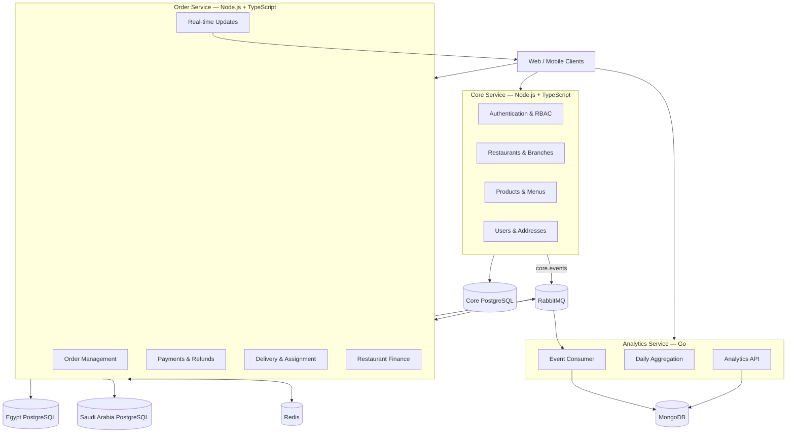

# QuickBite — Scalable Food Delivery Microservices Platform

**A distributed, multi-service food delivery platform engineered with Node.js, TypeScript, Go, PostgreSQL, MongoDB, Redis, and RabbitMQ.**

QuickBite is a Talabat-inspired food delivery platform designed around independent microservices, asynchronous event-driven communication, multi-country database sharding, real-time delivery tracking, and scalable analytics.

The platform separates core business operations, order processing, and analytical workloads into independently structured services, with a focus on maintainability, data consistency, fault isolation, and horizontal scalability.

---

## Architecture Overview

QuickBite consists of three core microservices, supported by dedicated infrastructure for caching, messaging, persistence, and performance testing.



### Microservices

| Service | Technology | Responsibilities |
|---|---|---|
| Core Service | Node.js, TypeScript, Express 5 | Authentication, users, restaurants, branches, products, menus, RBAC |
| Order Service | Node.js, TypeScript, Express 5 | Orders, payments, deliveries, agents, assignments, restaurant finance |
| Analytics Service | Go | Event consumption, analytical aggregation, read-only analytics APIs |

### Infrastructure

- **PostgreSQL:** Transactional persistence for core and order services.
- **MongoDB:** Analytical aggregates and read-optimized queries.
- **Redis:** Caching, idempotency, and WebSocket Pub/Sub.
- **RabbitMQ:** Asynchronous inter-service communication.
- **Socket.IO:** Real-time order and delivery updates.
- **AWS S3:** Restaurant media storage.
- **k6:** Load testing and performance validation.

---

## Key Engineering Highlights

### 1. Multi-Country Database Architecture

Designed a country-based database sharding strategy to support independent regional workloads.

- Egypt: `order_service_eg` (EGP).
- Saudi Arabia: `order_service_ksa` (SAR).
- Order databases partitioned by month.
- Country-aware routing and database selection.
- Independent regional data isolation.

### 2. Event-Driven Microservices

Implemented asynchronous communication using RabbitMQ Topic Exchanges.

**Event Flow:**

- `core.events`: Core service publishes restaurant, branch, product, and RBAC changes.
- `order.events`: Order service publishes business events for analytics processing.
- Durable exchanges and queues.
- Manual message acknowledgment.
- At-least-once delivery semantics.
- Duplicate event protection using Redis SETNX and MongoDB unique indexes.

### 3. Reliable Order & Payment Processing

Implemented reliability patterns for critical business operations:

- Idempotency keys for write operations.
- Redis-based idempotency with database persistence for critical paths.
- Transactional database operations.
- Outbox-based event publishing.
- Integer-based monetary representation to avoid floating-point precision errors.
- Payment integration with Kashier v3.
- Cash on Delivery (COD), payment webhooks, and refunds.

### 4. Real-Time Delivery Tracking

Implemented real-time order and delivery updates using:

- Socket.IO.
- Redis Adapter for cross-instance Pub/Sub.
- Agent presence and assignment workflows.
- Live order and delivery lifecycle updates.

### 5. Dedicated Analytics Service (Go)

Built a separate Go-based analytics service to process order events independently from transactional workloads.

The service consumes RabbitMQ events and maintains daily analytical aggregates in MongoDB.

| Aggregate | Metrics |
|---|---|
| Restaurant Daily | Orders, revenue, average order value |
| Branch Daily | Orders, revenue |
| Product Daily | Quantity sold, revenue |
| Platform Daily | Platform-wide totals |

Uses Go, Chi Router, MongoDB Driver, RabbitMQ, and structured logging with `slog`.

### 6. Performance & Load Testing

Developed a dedicated load-testing environment with deterministic seed scripts for all three datastores.

The full-scale test scenario is configured around:

| Metric | Target / Scenario |
|---|---:|
| Daily API Requests | ~54 Million |
| Peak Request Rate | ~625 req/s |
| Daily Orders | ~200,000 |
| Users | 1 Million |
| Restaurants | 1,000 |
| Branches | 3,000 |
| Products | 80,000 |

**Load Testing Stack:**
- k6 for traffic simulation.
- PostgreSQL and MongoDB deterministic data seeding.
- Realistic read/write traffic distribution.
- Country-specific order workloads.
- Separate local and full-scale test profiles.

*These figures represent the configured full-scale test scenario and design targets, not independently verified production traffic or benchmark results.*

---

## Technology Stack

| Category | Technologies |
|---|---|
| Languages | TypeScript, JavaScript, Go |
| Backend | Node.js, Express 5, Go, Chi |
| Databases | PostgreSQL, MongoDB |
| Query & Data Access | Knex.js, MongoDB Driver |
| Caching | Redis |
| Messaging | RabbitMQ, AMQP |
| Real-Time | Socket.IO, Redis Adapter |
| Authentication | JWT, RBAC, bcrypt |
| Validation | class-validator, Go Validator |
| Dependency Injection | tsyringe |
| Cloud Storage | AWS S3 |
| Testing | k6 |
| Infrastructure | Docker, Docker Compose |

---

## Architecture & Design Principles

The codebase follows strict architectural boundaries to maintain separation of concerns and testability.

**Three-Layer Infrastructure Structure:**

```text
src/
├── app/       # Business modules and application logic
├── lib/       # Application-aware infrastructure and integrations
└── pkg/       # Framework-agnostic reusable components
```

**Key Design Decisions:**

- No ORM/ODM: Explicit database access through Knex and MongoDB Driver.
- Dedicated Request and Response DTOs.
- Cursor-based pagination instead of offset pagination.
- Explicit database transactions with rollback handling.
- No floating-point monetary calculations.
- Idempotency for critical write operations.
- Centralized environment configuration and validation.
- No N+1 query patterns; use batched queries and joins.
- Separation of transactional and analytical workloads.

---

## Repository Structure

```text
QuickBite/
│
├── core-service/
│   ├── src/
│   │   ├── app/
│   │   │   ├── auth/
│   │   │   ├── user/
│   │   │   ├── restaurant/
│   │   │   ├── branch/
│   │   │   ├── product/
│   │   │   └── rbac/
│   │   ├── lib/
│   │   ├── pkg/
│   │   └── migrations/
│   └── Dockerfile
│
├── order-service/
│   ├── src/
│   │   ├── app/
│   │   │   ├── order/
│   │   │   ├── payment/
│   │   │   ├── delivery/
│   │   │   ├── assignment/
│   │   │   └── finance/
│   │   ├── lib/
│   │   ├── pkg/
│   │   └── migrations/
│   ├── docs/
│   └── Dockerfile
│
├── analytics-service/
│   ├── cmd/
│   ├── app/
│   │   └── analytics/
│   ├── lib/
│   ├── pkg/
│   ├── docs/
│   └── Dockerfile
│
└── loadtest/
    ├── seed-core.sql
    ├── seed-order.sql
    ├── seed-analytics.js
    ├── loadtest.js
    ├── seed.ps1
    ├── seed.sh
    └── README.md
```

---

## Getting Started

### Prerequisites

Make sure the following tools are installed:

- Node.js 20+
- Go 1.21+
- PostgreSQL 15+ with PostGIS
- MongoDB 6+
- Redis 7+
- RabbitMQ 3.12+
- k6

### 1. Clone the Repository

```bash
git clone <YOUR_REPOSITORY_URL>
cd QuickBite
```

### 2. Configure Environment Variables

Configure each service independently:

```bash
cd core-service
cp .env.example .env
```

Repeat for `order-service` and `analytics-service`.

Configure database connections, Redis, RabbitMQ, JWT secrets, and required external service credentials.

### 3. Start Core Service

```bash
cd core-service
npm install
npm run migrate
npm run dev
```

Runs on `http://localhost:3000`.

### 4. Start Order Service

```bash
cd order-service
npm install
npm run migrate:all
npm run dev
```

Runs on `http://localhost:4000`.

### 5. Start Analytics Service

```bash
cd analytics-service
go mod download
go run ./cmd/api
```

Runs on `http://localhost:4100`.

### 6. Run Load Tests

```bash
cd loadtest

# Seed local development data
./seed.ps1 -Profile local

# Run smoke test
k6 run -e PROFILE=local loadtest.js
```

For full-scale testing:

```bash
./seed.ps1 -Profile full

k6 run \
  -e CORE_URL=http://localhost:3000 \
  -e ORDER_URL=http://localhost:4000 \
  loadtest.js
```

---

## Engineering Challenges Addressed

| Challenge | Engineering Approach |
|---|---|
| Cross-service communication | RabbitMQ event-driven architecture |
| Duplicate write requests | Redis + database idempotency |
| Regional data growth | Country-based sharding |
| Large order tables | Monthly partitioning |
| Real-time delivery updates | Socket.IO + Redis Adapter |
| Analytics workload isolation | Dedicated Go analytics service |
| Message redelivery | At-least-once delivery + deduplication |
| Monetary precision | Integer minor-unit representation |
| Large dataset testing | Deterministic seeding + k6 |

---

## Future Improvements

The architecture is designed to accommodate additional capabilities, including:

- Read replicas and further database scaling.
- Analytics caching and dashboard WebSockets.
- Recommendation and personalization services.
- Loyalty and promotional systems.
- AI-assisted delivery optimization.
- Expanded observability and monitoring infrastructure.

---

## Author

**Ahmed Farag**

Software Engineer | Backend & Distributed Systems

- GitHub: [AhmedFarag22](https://github.com/AhmedFarag22)
- LinkedIn: [Ahmed Farag](https://www.linkedin.com/in/a7med-farag/)

---

*Built as an engineering project focused on distributed systems, scalable backend architecture, and real-world food delivery workflows.*
